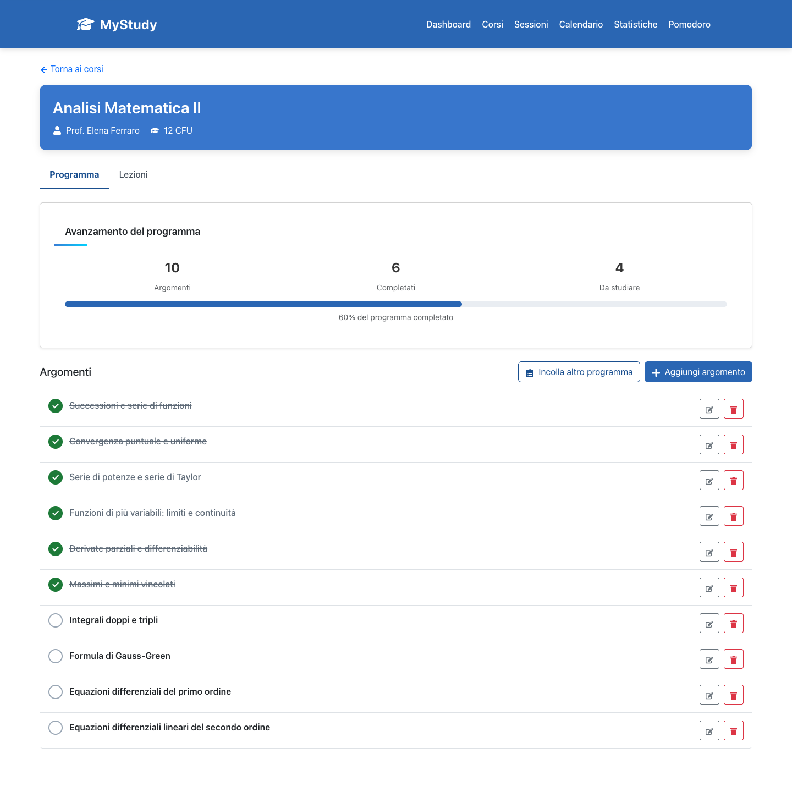
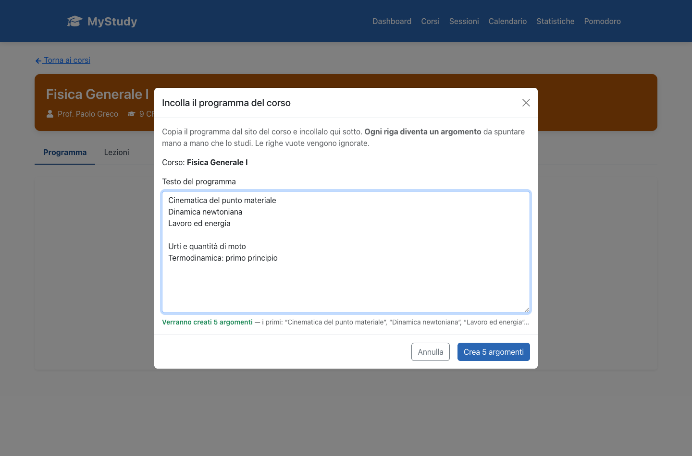
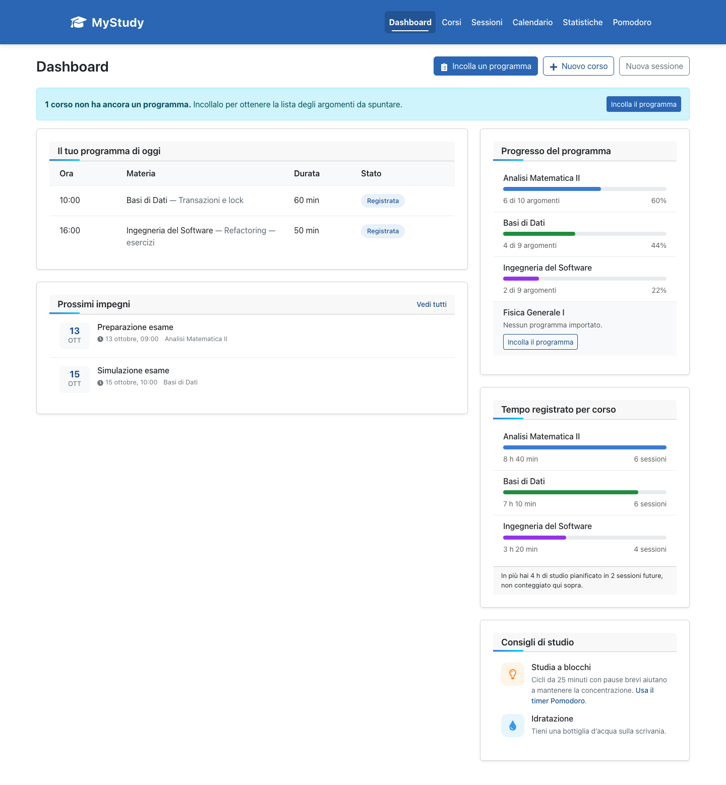
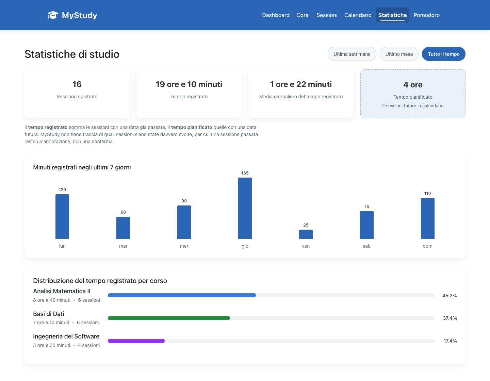
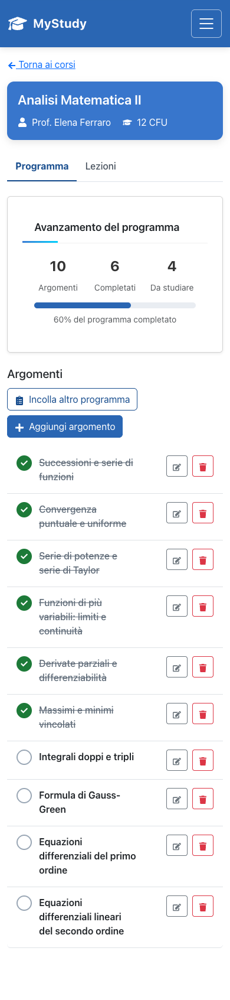

# MyStudy — rethinking how students plan for multiple exams

**Student product project · Politecnico di Milano · June 2025**

**By Mariia Sarbash** — application, presentation and delivery.
Research, product concept and initial UX developed jointly with **Matteo Soccali**.

Presented at **Bending Spoons HQ**, Milan, on **25 June 2025**, through the
CSI / Passion in Action initiative at Politecnico di Milano.

---

MyStudy started from a challenge familiar to many university students: preparing for several exams
at the same time without a clear understanding of how much work each one requires, or how to
distribute that work around classes and personal commitments.

We investigated the problem through a survey of approximately 200 university students in Milan. Our
product vision was an intelligent study-planning assistant that could analyse the materials a
student chose to provide across different courses, estimate the workload, and create a realistic
plan adapted to exam dates, priorities and available time.

The first full-stack prototype implemented a smaller foundation of that vision: organising courses
and topics, tracking progress, and recording study sessions.

📄 **[Read the original pitch deck — 25 June 2025](docs/mystudy-pitch-june-2025.pdf)** (12 slides, in Italian)



> **About this repository.** This is a historical portfolio piece, preserved rather than
> modernised. The interface is in Italian, for Italian university students. The README is in
> English, for everyone else.

---

## The problem

Preparing for several university exams is not simply a matter of finding time to study. Each course
comes with its own material, topics, deadlines and level of difficulty, and students often do not
know in advance how much time each exam will require.

A student has to decide what to study, when to study it, how much attention to give each subject,
and how to adjust those choices when other commitments or priorities change.

Without a unified view of the workload across all courses, it is difficult to build a realistic
plan rather than treating every exam in isolation.

That was the problem we wanted to understand and eventually help students solve — not a technology
looking for a use.

## Research & discovery

Before writing any code, we ran a survey of **approximately 200 university students aged 19–24**,
across Politecnico di Milano, Bocconi, Statale and Cattolica.

| Question | Leading answer |
|---|---|
| What is the biggest problem in your life as a university student? | **48.9%** — organising time across lectures, study and personal life |
| How important is it to you to solve that problem? *(1–5)* | **78%** chose 4 or 5 *(145 of the 186 answers to this question)* |
| Which task would most lighten your life if you could delegate it? | **45.7%** — creating a weekly study plan |

The open-ended answers all converged on the same need. One respondent asked for *"a planner that
tells me exactly what I have to do during the week so I don't fall behind — taking my wellbeing into
account too, I don't want to study until the middle of the night"* (translated from the Italian
original quoted in the presentation).

Taken together: a quantified problem, a quantified urgency, and a clear signal about the kind of
help students wanted — planning their study, across everything they had to prepare, rather than
any particular interface for doing it. That is the direction the product concept below follows.

*All figures are as reported in our June 2025 presentation. This was a student survey, not an
audited study, and the sample was a convenience sample of students we could reach. It tells us
what students said their problem was; it does not, on its own, validate any specific feature.*

## The product concept

The proposed MyStudy assistant would bring together the information a student chose to give it
about their courses, materials, exams and availability. Instead of planning each exam separately,
it would consider the overall academic workload: estimating what needed to be studied, assigning
priorities, and proposing a realistic study schedule.

The plan was meant to adapt — to different exam dates, to personal commitments, and to the
student's progress over time.

**The intelligent multi-exam planning engine was never implemented.** What the first prototype
delivered instead was the supporting layer around it: course management, pasted syllabi converted
into topic checklists, visible progress, study sessions, a calendar and a Pomodoro timer.

## What was actually built

A working full-stack prototype, in Italian:

| Feature | What it does |
|---|---|
| **Syllabus import** | Paste a course programme; every non-empty line becomes a topic. A live preview shows exactly how many topics will be created before you commit |
| **Topic checklist** | Tick topics off; per-course progress (`6 di 10 argomenti`, 60%) on the course page and the dashboard |
| **Courses** | Create, edit and delete courses with professor, CFU credits, colour and description |
| **Lessons** | A separate per-course list with dates, durations, notes and completion |
| **Study sessions** | Log study time against a course, with date, duration, topic and notes |
| **Calendar** | A month/week view of sessions, colour-coded by course (FullCalendar) |
| **Statistics** | Recorded study time, daily average, the last seven days as a bar chart, and the split across courses |
| **Pomodoro timer** | 25/5/15-minute cycles; a completed cycle can be saved as a study session |






*Screenshots of the 2026-maintained build. Interface in Italian; all data shown is fictional.*

## Vision versus implementation

The June 2025 presentation proposed an **AI-powered planner**: it would read study materials
uploaded by the user, estimate the time each topic needs, take exam dates and personal preferences
into account, and distribute the workload across the weeks automatically. Slide 10 sketched a
round trip through an OpenAI model selector.

**That was the product vision. It was never built, and nothing in this repository implements it.**
There is no LLM call, no API key, no file upload, no scheduling algorithm and no AI dependency
anywhere in the code.

What was built is deliberately simpler. The importer splits pasted text on line breaks, drops blank
lines, trims each remaining line and saves it as one topic, in order. **One line of text becomes one
topic** — that is the whole algorithm, and you can read it in
[`backend/controllers/topicController.js`](backend/controllers/topicController.js).

What the prototype did was take on the part of the vision that was achievable in the time
available, and build the structures the larger idea would have needed anyway: courses, their
topics, progress against them, and time recorded against each one. It is a foundation, not a
demonstration that the concept works — nothing here tested whether an automatically generated,
multi-exam study plan would actually help a student.

The deck is published unedited, AI slides included, because a product vision that outran a first
prototype is a normal and honest part of the story.

## Architecture & technology

```text
frontend/   React 19 · Vite · React Router · react-bootstrap · FullCalendar
backend/    Express 5 · Mongoose 8 · MongoDB
docs/       the original presentation and screenshots
```

A conventional two-tier application. The frontend calls the API with same-origin relative `/api`
paths and Vite proxies them to Express in development. The API is a small REST surface over four
Mongoose models — `Course`, `Lesson`, `Topic`, `StudySession` — with controllers, routes and a
central error handler. There is no authentication: MyStudy was designed as a single-user local
prototype.

## Original presentation — 25 June 2025

📄 **[docs/mystudy-pitch-june-2025.pdf](docs/mystudy-pitch-june-2025.pdf)** — the 12 slides as
presented, in Italian, unedited.

MyStudy was presented at Bending Spoons HQ in Milan on 25 June 2025, through the CSI / Passion in
Action initiative at Politecnico di Milano. Presenting there was part of that programme: it was not
a competition win, a partnership, a commercial engagement or an endorsement of the project by
Bending Spoons. The logos on the slides are contextual.

The PDF is included byte-for-byte as a historical artifact. It was re-exported from Canva after
2025, so its file metadata carries a later date and the exporting account's name; the presentation
itself is dated 25 June 2025 on slide 1.

## Team & contributions

**Mariia Sarbash** co-developed the research and the product concept with **Matteo Soccali**,
designed the software architecture, led the full-stack implementation using AI-assisted development
tools, and independently created and delivered the presentation at Bending Spoons HQ on
25 June 2025.

| | |
|---|---|
| Software architecture and full-stack implementation | Mariia Sarbash — led the build, using AI-assisted development tools |
| Presentation (12 slides) and its delivery | Mariia Sarbash — created and delivered independently |
| Survey design, distribution and analysis | Mariia Sarbash and Matteo Soccali — together, ~50/50 |
| Product concept, initial layout and UX | Mariia Sarbash and Matteo Soccali — together |

## Project evolution

**June 2025 — the original project.** Problem analysis, the survey, the prototype and the
presentation. That is what this repository is a record of.

**2026 — maintenance for the portfolio.** The repository was later brought back to a working state
and made presentable. That work is *not* part of the original project and should not be read as
something that existed in June 2025:

- migrated the frontend from Create React App to Vite (the old toolchain no longer built at all);
- consolidated three competing HTTP clients into one and fixed features that had never worked from
  the interface, including saving a Pomodoro session and editing a course;
- stopped tracking `node_modules` and environment files, and wrote a real `.gitignore`;
- made the layout responsive, raised contrast and keyboard accessibility to WCAG 2.1 AA for the
  application's own components, and rewrote the empty states;
- separated recorded from planned study time (see Limitations).

No feature from the AI vision was added, then or now.

**Where I am now.** For more recent work, see
**[Sorteat](https://github.com/mariisarbash/sorteat_high_fidelity)** — a later project whose design
and engineering standard reflects where my product and technical work is today. MyStudy is kept as
it is precisely so the distance between the two is visible.

## Limitations

- The core of the concept — analysing study materials and generating a plan across several exams —
  was never implemented. The importer is a deterministic line split.
- Study sessions have no completion state. The app distinguishes **recorded** time (sessions dated
  in the past) from **planned** time (sessions dated in the future) and labels the two separately,
  but it cannot know whether a session actually took place.
- Deleting a course leaves its topics and lessons in the database.
- There is no authentication, and no multi-user support. It is a single-user local prototype.
- There is no hosted demo. The screenshots above and the presentation are the evidence; the code
  runs locally in a couple of minutes.

## Running it locally

**Requirements:** Node.js 20 or newer, and a MongoDB instance you can write to.

```bash
git clone https://github.com/mariisarbash/mystudy.git
cd mystudy
npm install && npm run install:all

# Point the API at your database (see backend/.env.example for every variable)
cp backend/.env.example backend/.env
#   MONGODB_URI=mongodb://127.0.0.1:27017/mystudy
#   PORT=5001

npm run dev
```

`npm run dev` starts the API on <http://localhost:5001> and the frontend on
<http://localhost:3000>, with `/api` proxied to the API. `npm run build` produces the production
frontend in `frontend/dist`.

The app starts empty and walks you through creating a first course and pasting a syllabus.

## License

[MIT](LICENSE). The presentation in `docs/` is a historical document included for reference; the
third-party names and logos it contains belong to their respective owners.
